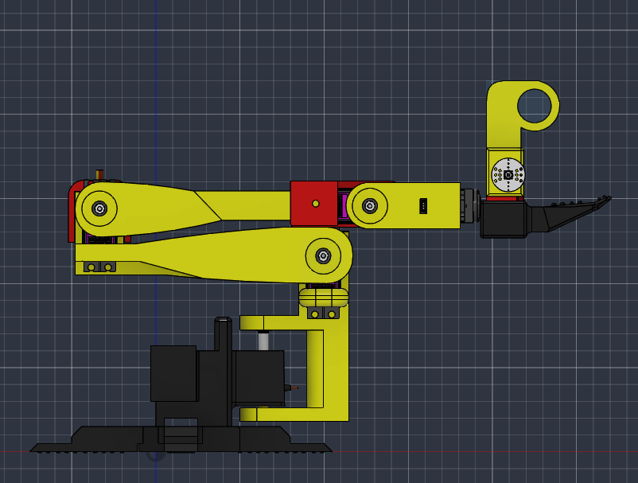
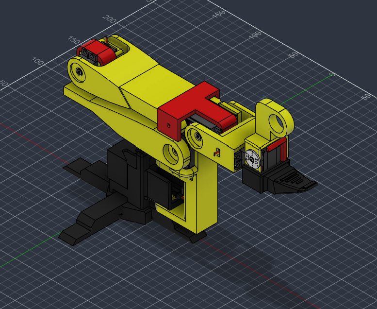
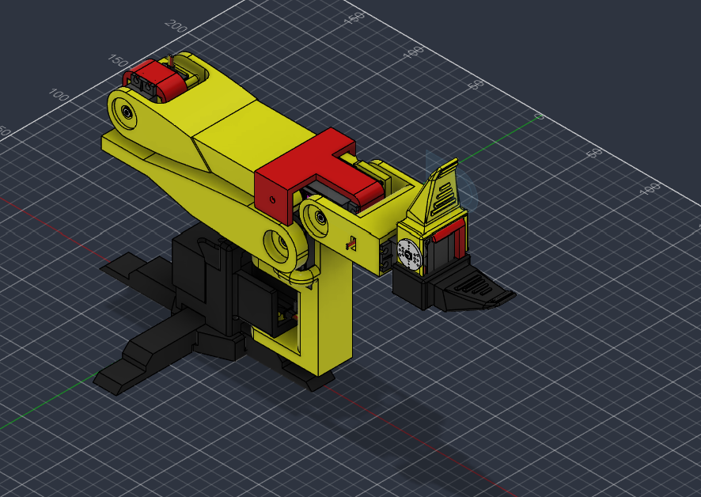
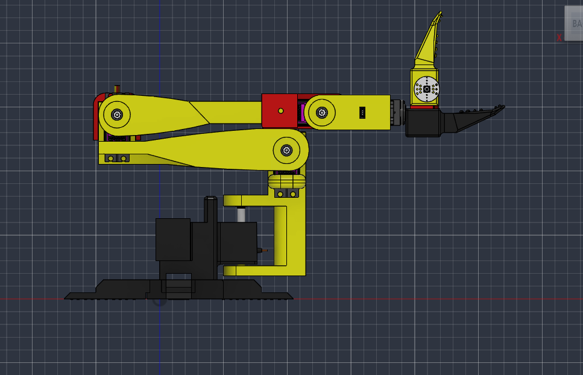

# Dexter-Robotic-Arm

5 DOF robotic arm

Completely made from scratch based on TowerPro MG946R Digital High Torque Metal Gear Servo Motor and SO101 model.

This is not a scaled-down version of SO101. This is completely new made which works with TowerPro MG946R Digital High Torque Metal Gear Servo Motor.

| Component | Quantity | Link |
|---|---:|---|
| TowerPro MG946R servo | 6 | [Robu.in](https://robu.in/product/towerpro-mg946r-digital-high-torque-metal-gear-servo-motor/) |
| Mini servo (MG90S or equivalent) | 1 | [Find MG90S](https://www.google.com/search?q=MG90S+mini+servo+India) |
| AS5600 magnetic encoder module | 5–6 | [Robu.in](https://robu.in/product/magnetic-encoder-sensor-module-as5600/) |
| Diametric magnets for AS5600 | 5–6 | Check whether included with the modules |
| TCA9548A I²C multiplexer | 1 | [Robu.in](https://robu.in/product/cjmcu-tca9548a-i2c-8-channel-multiple-extensions-development-board/) |
| PCA9685 16-channel servo driver | 1 | [Robu.in](https://robu.in/product/16-channel-12-bit-pwmservo-driver-i2c-interface-pca9685-arduino-raspberry-pi/) |
| ESP32-S3-DevKitC-1-N16R8 | 1 | [Amazon India](https://amzn.in/d/00UzSUMf) |
| Regulated servo power supply | 1 | [Amazon India](https://amzn.in/d/00Qqx9EG) |
| M3 screws | 30 | — |
| M3 heat-set inserts | 30 | — |
|9 mm × 20 mm |  10 | |

# image
some images of the model
- Yellow : moving parts
- Red : jointes
- Black : static 
### Leader arm

### Follower arm

